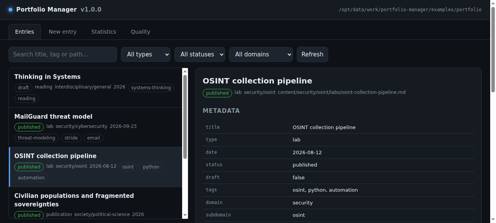

# Portfolio Manager

A dependency-free Python CLI **and local web UI** to create, update, check, index and publish a
Markdown portfolio.

Every entry is a Markdown file with a small YAML front matter block. Portfolio Manager keeps that
front matter consistent, validates the structure, generates indexes, produces homepage data and
prepares the tree for Hugo or GitHub Pages — without ever touching the prose you wrote.



## Why

A portfolio is a set of pages that must stay coherent: valid dates, sensible metadata, working
links, indexes that are not out of date, drafts that are clearly marked. Doing that by hand is
boring and error-prone; a static site generator will not enforce it either. Portfolio Manager is
the small, boring tool that does.

- **No dependency.** Python 3.10+ standard library only. Nothing to install to read your portfolio.
- **Markdown first.** The files stay readable in Obsidian, on GitHub and in Hugo. No database.
- **Non-destructive.** Updates rewrite the front matter only; the body is preserved.
- **Honest checks.** `pfm check` tells you what is broken and why, with stable codes.

## Quick start

```bash
git clone https://github.com/TKonate/portfolio-manager.git
cd portfolio-manager

# Optional: install the `pfm` and `portfolio-manager` commands
pip install -e .

# Create a portfolio skeleton (creates content/, data/ and config.json)
mkdir -p ~/portfolio && cd ~/portfolio
pfm init .

# Guided creation
pfm new project
```

Without installation, use the module: `python -m pfm ...` (or the legacy `python portfolio_manager.py ...`).

A new entry looks like this:

```text
portfolio/content/technology/computer-science/projects/portfolio-manager.md
```

```markdown
---
title: Portfolio Manager
type: project
date: 2026-11-17
status: published
draft: false
tags:
  - python
  - cli
  - markdown
domain: technology
subdomain: computer-science
repository: "https://github.com/TKonate/portfolio-manager"
---

# Portfolio Manager

## Contexte
...
```

## Commands

| Command | Aliases | What it does |
|---|---|---|
| `pfm new [type]` | `n`, `add`, `create` | Create an entry (guided, or fully scripted with flags) |
| `pfm list` | `ls`, `l` | List entries, filter by type / status / domain / tag |
| `pfm show <id>` | `cat` | Print an entry |
| `pfm update <id>` | `u` | Change status, title, date, tags or metadata; body untouched |
| `pfm update-status <id> <status>` | — | Shortcut for `update --status` |
| `pfm check` | `c`, `lint` | Validate front matter, paths, naming and metadata |
| `pfm stats` | `st` | Statistics, optionally written as `data/portfolio_stats.json` |
| `pfm index` | `i`, `idx` | Regenerate every `_index.md` page |
| `pfm hugo` | — | Check or normalise front matter for Hugo |
| `pfm serve` | `web`, `ui` | Local web interface on `http://127.0.0.1:8765` |
| `pfm init [path]` | `bootstrap` | Create a portfolio skeleton and a `config.json` |
| `pfm menu` | — | Interactive menu (also the default when no command is given) |

Options can be written either before or after the command:

```bash
pfm --portfolio-root ~/portfolio check
pfm check --portfolio-root ~/portfolio
```

### Creating without prompts

```bash
pfm new publication \
  --title "Civilian populations and fragmented sovereignties" \
  --domain society --subdomain political-science \
  --tags "political-science, osint, sahel" \
  --date 2026 --status published \
  --source-url https://example.org/publication \
  --bundle --pdf ~/papers/paper.pdf \
  --no-input
```

`--bundle` creates a Hugo page bundle (`<slug>/index.md`) and copies the local PDF next to it; the
front matter only ever stores the file name, never an absolute path.

### Updating

```bash
pfm update content/.../entry.md --status published --add-tag featured
pfm update content/.../entry.md --repository https://github.com/me/project
pfm update content/.../entry.md --remove-field repository
pfm update content/.../entry.md --status published --dry-run
```

The Markdown body and any hand-written front matter key are preserved; known keys are reordered to
the canonical order so diffs stay small.

### Checking

```bash
$ pfm check
ERROR   E011 content/technology/computer-science/labs/bench.md: file lives in labs/ but its type is 'project' (expected projects/)
WARNING W010 content/technology/computer-science/projects/tool.md: published project without a repository URL
2 entries checked, 1 error(s), 1 warning(s)
```

Exit codes: `0` clean, `1` errors (or warnings with `--strict`), `2` command-line usage error.
`pfm check --json` returns the same report as machine-readable JSON.

### Statistics and homepage data

```bash
pfm stats                 # readable summary
pfm stats --json          # JSON on stdout
pfm stats --write         # writes <portfolio>/data/portfolio_stats.json
```

The JSON contains totals by type/status/domain, top tags, published projects, publications with and
without PDF, drafts and the list of incomplete entries.

### Indexes

```bash
pfm index                 # relative links (GitHub / Obsidian friendly)
pfm index --hugo-links    # absolute pretty URLs for Hugo
pfm index --no-drafts     # leave drafts out
pfm index --dry-run       # show what would be written
```

Four levels are generated: `content/_index.md`, one per domain, one per subdomain and one per
content type. Every generated page carries a `<!-- generated by portfolio-manager -->` marker.

### Hugo / GitHub Pages

```bash
pfm hugo            # report Hugo-specific problems
pfm hugo --apply    # normalise front matter (draft flag, key order) in place
```

`draft` is always a boolean derived from `status`, dates are written unquoted so Hugo parses them,
and indexes are already `_index.md` files.

## Web interface

```bash
pfm serve                 # http://127.0.0.1:8765
pfm serve --open --verbose
```

- browse, search and filter entries;
- see the metadata and a rendered preview of any entry;
- create an entry with a form (type, domain, subdomain, tags, status, type-specific fields);
- change the status, edit the metadata or delete an entry;
- compute statistics, write the homepage JSON, run the checks, regenerate the indexes.

The server binds to `127.0.0.1` only, refuses cross-origin requests and unknown `Host` headers, and
resolves every entry id inside the portfolio root — a request cannot read or write outside it.

## Configuration

`config.json` lives next to the portfolio or anywhere else, `--config` then points to it:

```json
{
  "portfolio_root": "../portfolio",
  "default_tags": ["portfolio"],
  "domains": {
    "technology": ["computer-science", "electronics"],
    "security": ["cybersecurity", "osint"],
    "society": ["political-science", "sociology"],
    "interdisciplinary": ["general"]
  }
}
```

Only `portfolio_root` is mandatory; `domains` and `default_tags` are optional. Relative paths are
resolved from the directory containing `config.json`, never from the current working directory. The
file is looked up in this order: `--config`, `$PFM_CONFIG`, `./config.json`, repository root.

## Demo portfolio

`examples/portfolio` is a complete, generated portfolio (6 entries, one page bundle with a PDF, all
indexes and the statistics JSON). It is rebuilt by `python examples/build_demo.py`.

```bash
pfm -c examples/portfolio/config.json check
pfm -c examples/portfolio/config.json stats
pfm -c examples/portfolio/config.json serve
```

## Project structure

```text
portfolio_manager.py       Legacy entry point (forwards to pfm.cli)
pfm/
├── cli.py                 Argument parsing, subcommands, interactive menu
├── config.py              config.json loading and validation
├── models.py              Vocabulary (types, statuses, fields) and the Entry model
├── frontmatter.py         YAML front matter reader/writer (no PyYAML)
├── naming.py              Slugs, tags and target paths
├── validate.py            Field validation shared by create/update/check
├── store.py               Discovery, atomic write, safe entry-id resolution
├── create.py              Create entries and Hugo page bundles
├── update.py              Metadata updates that preserve the body
├── check.py               Quality checks with stable codes
├── stats.py               Statistics and homepage data
├── index.py               _index.md generation
├── hugo.py                Hugo normalisation and validation
├── markdown.py            Small, safe Markdown → HTML renderer for the preview
├── prompts.py             Guided prompts and the interactive menu
├── server.py              Local HTTP API and static file server
├── web/                   index.html, app.js, style.css (no build step)
└── templates.py           Markdown bodies per content type
tests/                     278 tests, standard library unittest (pytest compatible)
examples/                  Demo portfolio and its generator
docs/                      Architecture notes and screenshot
```

More detail: [docs/architecture.md](docs/architecture.md).

## Development

```bash
python -m venv .venv && source .venv/bin/activate
pip install -e ".[dev]"

pytest -q                                  # or: python -m unittest discover -v
ruff check .
mypy
pytest --cov=pfm --cov-report=term-missing
```

Or with the Makefile:

```bash
make test lint typecheck coverage
```

CI runs the suite on Python 3.10, 3.11, 3.12 and 3.13 with ruff and mypy enforced.

## Design decisions

- **Standard library only.** The tool must still run in five years, from a USB stick, without a
  virtualenv. PyYAML is replaced by a 150-line parser for the small subset the portfolio uses.
- **The file is the database.** No state outside the Markdown tree; `git diff` is the audit log.
- **Web UI rather than Tkinter.** It works on a headless machine, needs no toolkit, and can be
  tested end to end in CI by speaking HTTP to a loopback server.
- **Non-destructive updates.** Front matter is rewritten, the body is preserved verbatim (only the
  blank line separating the two is normalised).
- **Validation before writing.** Every value is checked before the file is created, so a failed run
  never leaves a half-written entry.

## Limits

- Moving an entry between domains or renaming a file is a manual `git mv` (the front matter can be
  updated afterwards with `pfm update`).
- The web UI has no authentication: it is a local tool, keep it on loopback.
- The Markdown preview implements the subset used by the templates, not full CommonMark.

## Roadmap

See [ROADMAP.md](ROADMAP.md). Versions V1 to V10 are implemented since `1.0.0`; what comes next is
tracked there as "beyond 1.0".

## License

MIT
